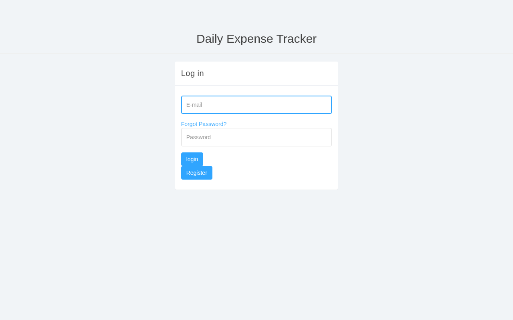
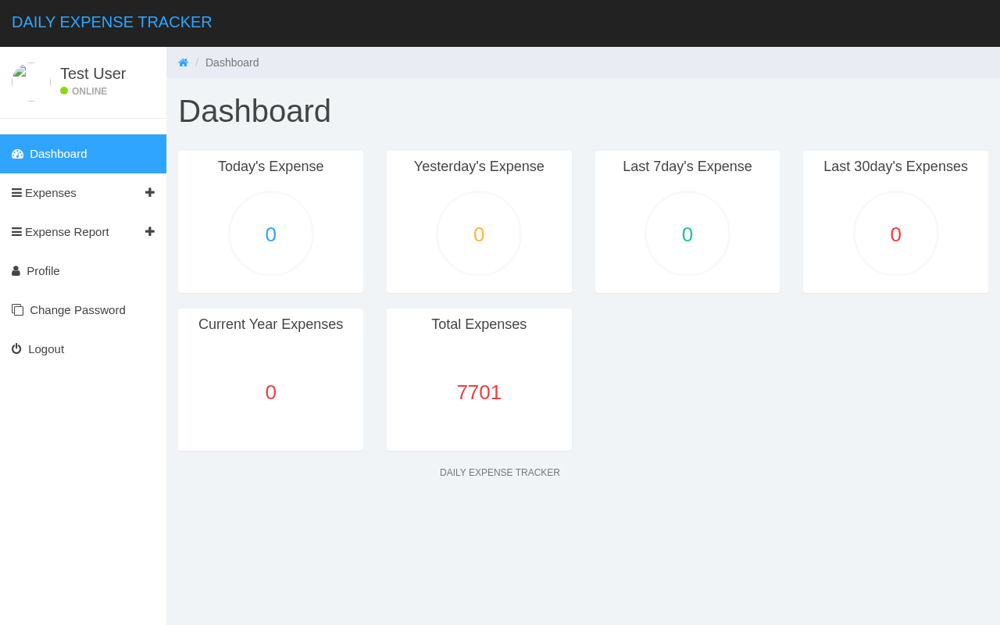
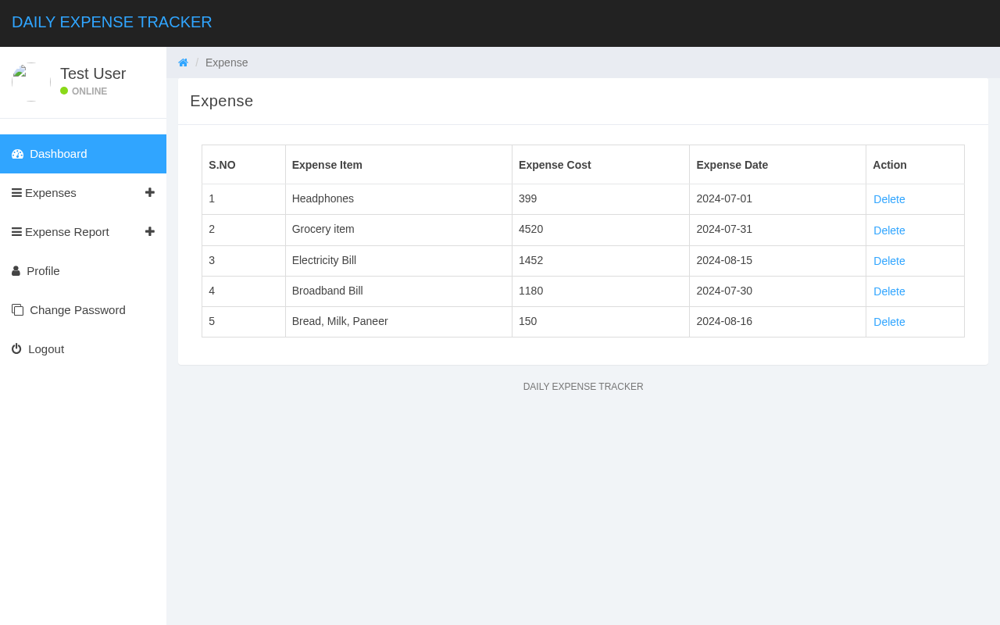
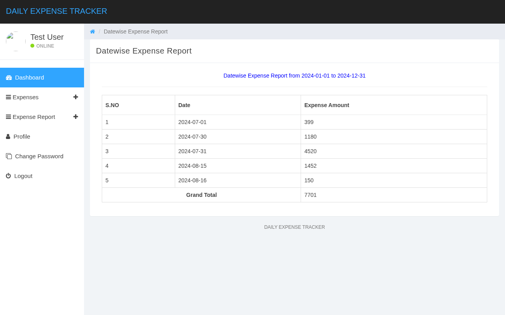

# Daily Expense Tracker

[](https://github.com/Roopashree935/Daily-expense-tracker/actions/workflows/ci.yml)

A small web application for recording day-to-day expenses and reviewing them as
date-wise, month-wise and year-wise reports. Written in **procedural PHP with
mysqli** against **MySQL / MariaDB** — no framework, no Composer, no build step.

It began as a college project and has since been through a security and
maintenance pass (see [What changed](#what-changed)).

| Login | Dashboard |
|---|---|
|  |  |

| Manage expenses | Date-wise report |
|---|---|
|  |  |

---

## What it does

* Register with name, email, mobile number and password; log in and out.
* Forgot-password flow: email + mobile number, then set a new password.
* Add an expense (date, item, cost); list them 10 to a page; delete one.
* Dashboard cards: today, yesterday, last 7 days, last 30 days, this year, all time.
* Reports: date-wise, month-wise, year-wise, each with a grand total for the range.
* Profile (name and mobile) and change-password pages.

## Tech stack

| Layer | What is used |
|---|---|
| Server | PHP 8.2 (procedural, `mysqli` prepared statements) |
| Database | MySQL / MariaDB — schema in `database/detsdb.sql` |
| Front end | Bootstrap 3.3, jQuery 1.11, Font Awesome 4.7, Chart.js, EasyPieChart |
| Bundled assets | `css/`, `js/`, `fonts/`, `sass/` — all vendored locally, no CDN |

`mysqli_stmt_get_result()` is used by `includes/db.php`, so the `mysqlnd` driver
must be enabled. It is the default in XAMPP, WAMP, Debian/Ubuntu `php-mysql` and
on InfinityFree.

## Repository layout

```
.
├── index.php  register.php  logout.php
├── dashboard.php
├── add-expense.php  manage-expense.php
├── expense-reports.php                    report chooser
├── expense-{datewise,monthwise,yearwise}-reports.php           (+ -detailed)
├── user-profile.php  change-password.php
├── forgot-password.php  reset-password.php
│
├── includes/
│   ├── dbconnection.php   loads config, sets error handling, opens $con
│   ├── config.example.php committed template — copy it to config.php
│   ├── config.php         your real credentials (git-ignored, not in the repo)
│   ├── db.php             db_rows() / db_row() / db_exec() — prepared statements
│   ├── auth.php           is_logged_in() / require_login() / login_user()
│   ├── password.php       hash_password() / verify_password() + md5 migration
│   ├── csrf.php           csrf_token() / csrf_field() / csrf_check()
│   ├── validate.php       date, amount, mobile, email, name checks
│   ├── escape.php         e() — htmlspecialchars for output
│   ├── header.php  sidebar.php  footer.php
│   └── .htaccess          denies direct HTTP access to this folder
│
├── database/detsdb.sql    schema + sample rows
├── docs/synopsis.pdf      project synopsis
├── docs/screenshots/      the images above
├── tests/smoke.php        php tests/smoke.php — is the install wired up?
├── tests/e2e.sh           bash tests/e2e.sh — 54 checks against a running copy
├── .github/workflows/     ci.yml (every push) and deploy-ftp.yml (manual)
├── .htaccess              security headers, no directory listings
├── css/  js/  fonts/  sass/  tables/
└── README.md
```

---

## Running it locally (XAMPP)

1. Install [XAMPP](https://www.apachefriends.org/) and start **Apache** and
   **MySQL** from the control panel.
2. Copy this folder into `htdocs`, e.g. `C:\xampp\htdocs\daily-expense-tracker`.
3. Create the database and import the schema. Either use phpMyAdmin
   (`http://localhost/phpmyadmin` → New → database name `detsdb` → Import →
   `database/detsdb.sql`), or from a terminal:

   ```bash
   mysql -u root -e "CREATE DATABASE detsdb"
   mysql -u root detsdb < database/detsdb.sql
   ```

4. Open `http://localhost/daily-expense-tracker/`.

That is all: `includes/config.php` does not exist yet, so
`includes/dbconnection.php` falls back to `includes/config.example.php`, whose
values are the stock XAMPP ones (`localhost`, user `root`, empty password,
database `detsdb`). Nothing to edit to get started.

**Demo account:** `testuser@gmail.com` / `Test@123` (also `rahul@test.com` and
`johndoe12@gmail.com` with the same password). These are seeded demo rows — see
[Limitations](#limitations).

### Using your own database credentials

```bash
cp includes/config.example.php includes/config.php
```

Then edit `includes/config.php`:

```php
return [
    'db_host' => 'localhost',
    'db_name' => 'detsdb',
    'db_user' => 'root',
    'db_pass' => '',
    'db_port' => 3306,
    'app_env' => 'dev',   // 'dev' shows PHP errors, 'prod' logs them only
];
```

`includes/config.php` is listed in `.gitignore`. Never commit it.

### Checking the install

```bash
php tests/smoke.php
```

It connects with your config and asserts that both tables and all the columns
the pages query are present. Exit code `0` means fine, `1` means something is
missing and the output says what.

---

## Hosting

**GitHub Pages cannot host this application.** Pages serves files straight from a
repository with no interpreter behind it, so a `.php` file is delivered as plain
text instead of being executed — a request for `index.php` shows its own source.
That is a property of static hosting, not a setting to switch on. The app needs a
host that runs PHP and a MySQL database.

### Deploying to free hosting (InfinityFree)

Free, PHP + MySQL, free SSL, no credit card. As of a September 2026 survey of
free hosts it was still free; free tiers change, so confirm before you rely on it.

1. Sign up and create a hosting account with a free subdomain.
2. Control panel → **MySQL Databases** → create a database. Note the **host**,
   database name, user and password.
3. phpMyAdmin → import `database/detsdb.sql`.
4. `cp includes/config.example.php includes/config.php` and fill in the values
   from step 2, with `'app_env' => 'prod'`.
5. Upload the contents of this folder into `htdocs`, so that `index.php` sits at
   the web root and not inside a subfolder.
6. Visit your subdomain.

**The gotcha:** the MySQL host is **not** `localhost` on InfinityFree. It looks
like `sqlXXX.infinityfree.com`, and it is on the database page, not in the email.

`.github/workflows/deploy-ftp.yml` automates the upload once you have the
account: add `FTP_SERVER`, `FTP_USERNAME`, `FTP_PASSWORD` and `APP_CONFIG_PHP`
(the full text of your `includes/config.php`) as repository secrets, then run the
workflow from the Actions tab. It writes `config.php` on the runner so the
credentials never enter the repository. **That workflow has never been run** —
there was no hosting account to run it against — so treat its first run as a
test.

Hosts to avoid for this app: Render (free database deleted after 30 days),
Fly.io, Koyeb, 000webhost (no longer free), and Vercel / Netlify / Cloudflare
Pages / GitHub Pages — those serve static files only and cannot run PHP.

---

## Security notes

What is in place now, and why:

| Concern | What the code does |
|---|---|
| SQL injection | Every query is a prepared statement (`includes/db.php`). No value is concatenated into SQL. |
| Password storage | `password_hash()` / `password_verify()` (bcrypt). Rows still holding an old md5 hash are re-hashed automatically on the next successful login. |
| CSRF | Every form carries a per-session token (`includes/csrf.php`) and every POST handler verifies it. The delete action is a POST, not a GET link. |
| Session fixation | `session_regenerate_id(true)` runs on login. |
| XSS | Every value printed into HTML goes through `e()` (`htmlspecialchars` with `ENT_QUOTES`). |
| Access control | `require_login()` on all 13 protected pages; every query that touches expenses or the profile also filters on the session's user id. |
| Input validation | Dates must be real `Y-m-d` dates, costs numeric, mobile numbers 10 digits, emails valid, passwords at least 8 characters (`includes/validate.php`). |
| Credentials | Out of the repository: `includes/config.php`, git-ignored, with a committed example. |
| Errors | `error_reporting(E_ALL)` always; display depends on `app_env`. Connection errors are logged, not echoed. |
| Headers & files | `.htaccess` sets `X-Content-Type-Options`, `X-Frame-Options` and `Referrer-Policy`, disables directory listings, and denies `includes/` and `*.sql`. |

### Limitations

These are real and known — this is a learning project, not a production system.

* **The forgot-password flow does not send email.** Knowing an account's email
  and mobile number is enough to reset its password. A real deployment needs a
  mailed one-time link with an expiry, and rate limiting.
* **No rate limiting or lockout** on login or password reset, so passwords can be
  guessed at whatever speed the host allows.
* **The demo accounts and their passwords are in `database/detsdb.sql`.** Delete
  those rows (and the sample expenses) before putting this anywhere public.
* **`tblexpense.ExpenseCost` is a `varchar(200)`, not `DECIMAL`.** Values are
  validated as numbers before insert, but `SUM()` still casts text to a number,
  so a stored `99.50` prints as `99.5` in reports. A migration to
  `DECIMAL(10,2)` is the proper fix and needs a data conversion first.
* **`.htaccess` needs Apache.** It is ignored by `php -S` and by nginx, so under
  those the `includes/` folder and the headers are not protected — configure the
  web server instead.
* **The sidebar avatar points at `http://placehold.it/...`**, an external
  service. It fails offline and would be blocked as mixed content on an HTTPS
  site. Replace it with a local image or remove the element.
* **`dashboard.php` ends with a Chart.js call for a canvas (`line-chart`) that
  the page does not contain**, so it logs one console error. The pie charts are
  unaffected.
* **`js/html5shiv.js` is referenced but the file is `js/html5shiv.min.js`.** It
  only affects Internet Explorer below 9.
* **The automated tests cover the pages, not the browser.** `tests/e2e.sh`
  drives the app over HTTP with curl, so it proves the server's responses; it
  cannot catch a layout break or a JavaScript error, and the `.htaccess`
  behaviour is not covered by CI because that needs Apache.
* **Not production-ready.** No logging of security events, no audit trail, no
  backups, no HTTPS handling of its own.

---

## What changed

The project was reviewed and hardened in a series of small commits, each one
concern:

| Commit | What it did |
|---|---|
| `fix: remove whitespace before the opening PHP tag` | `manage-expense.php` began with two spaces, which broke `session_start()` and every `header()` redirect on the page. |
| `chore: delete unreferenced images and CSS source maps` | ~1.7 MB of unused theme images and 984 KB of devtools maps, after grepping that nothing referenced them. |
| `fix: replace the accidental session guard with an explicit one` | The `strlen($_SESSION['detsuid']==0)` guard worked by accident; `includes/auth.php` replaces it and adds `session_regenerate_id()`. |
| `fix: move DB credentials into config.php and stop hiding PHP errors` | Credentials out of git; `error_reporting(0)` replaced by a dev/prod switch. |
| `fix: replace every interpolated query with a prepared statement` | 30 call sites across 14 page files, plus the new `includes/db.php`. |
| `fix: hash passwords with password_hash() and migrate the md5 rows` | bcrypt, with a migration that does not lock anyone out. |
| `feat: add CSRF tokens to every form and to the delete action` | 12 forms, 12 handlers, delete changed from GET to POST. |
| `feat: validate dates, amounts, mobile numbers and emails server-side` | `includes/validate.php`, applied to every write. |
| `fix: only let a user delete their own expenses` | The delete trusted the id alone — an IDOR found during the review. |
| `fix: escape every value printed into the page` | Stored XSS in expense items, names and report ranges. |
| `chore: add .htaccess files for headers and to close includes/` | Headers, no listings, `includes/` and `*.sql` denied. |
| `feat: paginate the expense list` | 10 rows per page with a stable `ORDER BY`. |
| `test: add tests/smoke.php` | Install check with a meaningful exit code. |
| `docs: rewrite the README` | This file. |
| `ci: lint, smoke-test and end-to-end-test every push` | `tests/e2e.sh` (54 checks) and the GitHub Actions workflow that runs it against MySQL 8. |
| `fix: make tests/smoke.php work on MySQL 8 as well as MariaDB` | Caught by the first CI run: information_schema column names are upper case on MySQL 8. |

---

## How this was verified

Most of this now runs on every push and pull request — see the CI badge at the
top of this file. The workflow lints every PHP file, imports the schema into a
throwaway MySQL 8, runs `tests/smoke.php`, then serves the app with PHP's
built-in server and runs `tests/e2e.sh` (54 checks), failing if the server log
contains a single warning, notice or fatal error.

What I ran by hand, on PHP 8.2.32 with MariaDB 10.11.18 on Debian 12, with the
schema imported fresh from `database/detsdb.sql`:

* `php -l` on all 30 PHP files — no syntax errors.
* The same end-to-end checks as CI, plus ten more that need direct database
  access (64 in total at the time), covering the login flow, both SQL-injection
  payloads (`' OR '1'='1` and `' OR 1=1 -- `), CSRF rejection (missing and wrong
  token), session-id rotation, add/list/delete, cross-user delete refusal, all
  four reports, pagination, the password migration, registration,
  change-password, validation and stored-XSS escaping — with zero PHP warnings
  or notices in the server log.
* The same app under Apache 2.4.68 with mod_php: 14 checks on the `.htaccess`
  behaviour (headers present, `includes/` and `database/detsdb.sql` returning 403,
  CSS and JS still served).
* `php tests/smoke.php` in three states: schema present (16 checks, exit 0),
  schema missing (exit 1), database missing (exit 1).

Not verified: behaviour under Internet Explorer, the forgot-password flow with a
real mail server (there is no mail server), and anything on InfinityFree — the
deployment steps above are from their documentation, not from a live upload.

---

## License

No licence file is included. The bundled front-end libraries
(Bootstrap, jQuery, Font Awesome, Chart.js, EasyPieChart) keep their own
licences; see the headers of the files in `css/` and `js/`.
